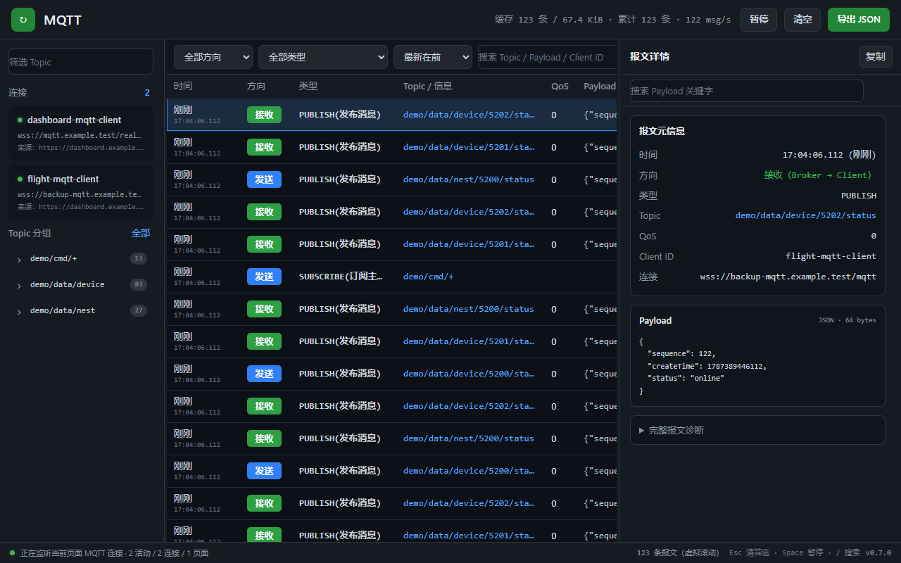

# MQTT Local DevTools

一个用于本地、测试和线上页面的 Chrome / Edge DevTools 网络调试插件。它能查看页面已有的 MQTT over WebSocket 连接和报文，按完整 Topic 分析连续消息的字段变化，也能导入浏览器复制的 cURL，编辑参数、请求头和 Body 后手动发送 HTTP 请求。MQTT 模块不会创建第二个 MQTT 客户端。

当前版本：**v0.8.5** · [下载扩展安装包](https://github.com/ganghao1024/mqtt-local-devtools/releases/download/v0.8.5/mqtt-local-devtools-0.8.5-cws.zip) · [版本更新说明](https://github.com/ganghao1024/mqtt-local-devtools/releases/tag/v0.8.5)



## 功能

- 业务故障分析：完整 Topic 对应一个设备，无需配置即可与上一条消息比较或手动指定 A/B；按字段展示新增、删除和修改。
- 字段表分析：选择分组下的一个完整 Topic，输入 N，点击“分析”；每条消息一行，多个指定字段各占一列，留空显示全部字段，未变化消息仍保留。字段表和逐条变化最新在前，字段规律按最近变化排序。
- 冻结分析现场：点击“分析”后不再自动收录新消息；需要新一轮时，点击“获取最新 N 条”主动取样，完成后继续冻结。
- 独立分析缓存：最多 5000 条 / 32 MiB，当前面板会话内仅用户手动清空；满后停止写入，保留现场。主列表的清空、淘汰不影响分析缓存。
- 分析导出：变化报告、原始数据可分别导出或一起导出，保留原有普通 JSON 导出；三种模式均记录本次选择与配置，原文与逐条变化保留原始捕获顺序。
- 中间报文列表支持 Payload 字段分类：输入 `sn` 递归查找同名字段，或输入 `data.sn` 指定路径；点击字段值标签筛选，并显示各类报文数量，可与 Topic、连接、方向和搜索共同使用。
- 在 MQTT 报文、HTTP 请求和故障分析三个模块之间切换
- 粘贴 Chrome / Edge “Copy as cURL (bash/cmd)” 内容并自动解析 Method、URL、Query、Headers 和 Body
- 在发送前启用、禁用、新增或删除 Query 参数和请求头，并编辑 JSON / Text Body
- 显示 HTTP 状态码、耗时、大小、格式化 JSON 响应和响应头
- cURL 导入、请求配置和响应三个区域可通过上下分隔条调整高度；方向键可微调，双击恢复默认
- 展示连接地址、Client ID、MQTT 版本和连接状态
- 解析 MQTT 3.1.1 与 MQTT 5.0 常用报文
- 展示发送和接收的 CONNECT、PUBLISH、SUBSCRIBE、PING、ACK 等报文
- 展示 Topic、QoS、retain、文本/JSON Payload 和二进制十六进制预览
- 按连接、方向、报文类型和关键词筛选
- 左侧按 Topic 前三级自动分组并统计报文数，分组可展开到具体 Topic 并进行精确筛选
- Topic、报文列表、报文详情三栏均可拖动分隔线调整宽度，宽度会自动保存；方向键可微调，双击分隔线恢复默认
- 顶部实时显示报文总数和最近一秒接收速率，底部显示监听状态与快捷键
- 时间排序支持倒序（最新在前）和正序（最新在后），选择会自动保存
- 来源页面刷新时自动移除该标签页旧 session 的连接和报文，再显示重新建立的连接
- 暂停界面刷新、复制报文详情、导出 JSON
- 报文详情拆分为元信息、格式化 Payload 和可展开的完整诊断；支持关键字搜索、高亮全部匹配，并用 Enter / Shift+Enter 前后跳转
- 报文详情使用独立的浏览器原生滚动视口，支持滚轮、触控板、拖动滚动条和键盘滚动
- 高频消息以 16ms 帧级批次传输，面板约 125ms（8 FPS）合并刷新，并通过虚拟滚动只维护可视区域报文行
- 鼠标悬停、滚动和筛选输入不会暂停实时渲染；只有点击“暂停”或按 Space 才暂停界面刷新
- 所有 HTTP/HTTPS 域名和 IP 页面默认启用
- 支持 localhost、局域网 IP、公网 IP 和线上域名页面
- 本地开发页面的 MQTT 面板可聚合所有 localhost/127.0.0.1 标签页的连接，并显示来源页面；线上页面的数据按当前被检查标签页隔离

## 支持范围

| 页面环境 | 是否支持 | 说明 |
| --- | --- | --- |
| localhost / 127.0.0.1 | 支持 | 可跨本地端口聚合连接，方便同时调试多个前端页面 |
| 局域网或公网 IP | 支持 | 页面需要使用 HTTP/HTTPS，并在插件授权范围内 |
| 线上域名 | 支持 | HTTP/HTTPS 页面中的 `ws://` / `wss://` MQTT 均可监听 |
| 原生 TCP MQTT | 不支持 | `mqtt://`、`mqtts://` 不经过浏览器 WebSocket API |

无论本地还是线上，监听器都必须在页面创建 WebSocket 前注入。因此安装或重新加载插件后，需要刷新目标页面。插件不会绕过网站登录、访问控制或浏览器安全策略，只能查看当前页面自身可访问并创建的 WebSocket 数据。

## 安装

### 从 GitHub Release 安装

1. 在 [GitHub Releases](https://github.com/ganghao1024/mqtt-local-devtools/releases) 下载最新的 `mqtt-local-devtools-*-cws.zip`。
2. 解压 ZIP 文件。
3. 打开 Chrome 的 `chrome://extensions` 或 Edge 的 `edge://extensions`。
4. 开启“开发者模式”。
5. 点击“加载已解压的扩展程序”，选择刚才解压的目录。
6. 打开需要调试的本地或线上页面并刷新，然后在 DevTools 顶部选择 **MQTT** 面板。

更新已有扩展时，将新版解压到原扩展目录，进入扩展管理页点击“重新加载”，再重新打开 DevTools 并刷新被调试页面。分析缓存只在当前面板会话内保留，更新前可通过“导出分析”“导出原文”或“一起导出”保存需要的材料。

### 从源码安装

1. 打开 Chrome 的 `chrome://extensions` 或 Edge 的 `edge://extensions`。
2. 开启“开发者模式”。
3. 点击“加载已解压的扩展程序”。
4. 选择克隆或下载后的项目根目录（该目录中应直接包含 `manifest.json`）。
5. 打开需要调试的本地或线上页面并刷新。
6. 打开浏览器开发者工具，在顶部选择 **MQTT** 面板。

插件安装时会请求所有 HTTP/HTTPS 网站的访问权限，以便在页面脚本创建 WebSocket 前注入 MQTT 监听器，以及在用户明确点击“发送”后访问所填写的 HTTP/HTTPS 目标。

## 使用说明

插件必须在 WebSocket 创建前注入监听器，因此首次安装、重新加载插件或刚授权站点后都要刷新被调试页面。面板打开得晚也没关系：DevTools 未连接时，每个页面最多回放最近 1000 个事件且不超过 8 MiB；DevTools 已连接并实时接收后，页面回放窗口自动缩短为 200 个事件且不超过 2 MiB。任一限制先达到时淘汰最旧事件，新报文继续实时写入。

### 高频报文性能

- MQTT 接收、解析与缓存保持实时，DevTools UI 固定约 8 FPS 合并刷新，避免高频报文阻塞页面。
- 报文列表使用虚拟滚动，即使缓存 5000 条也只创建当前可视区域附近的 DOM 行。
- 连接列表与 Topic 分组使用互不覆盖的独立滚动区域；大量 Topic 展开后不会挤压或遮挡连接卡片。
- Topic 分组、缓存总数与实时速率增量维护；全局搜索文本在接收时预计算，并带约 150 ms 防抖。
- 页面侧使用自适应环形缓冲区：待机时 1000 条或 8 MiB，DevTools 已连接时缩短为 200 条或 2 MiB；DevTools 面板独立保留 5000 条或 32 MiB。

localhost、回环地址和局域网 IP（10.x、172.16–31.x、192.168.x 等）页面可以查看该页面连接到任意 hostname 的 MQTT Broker；线上页面仍要求 Broker 与来源页面的 hostname 相同，端口可不同。DevTools 底部及插件弹窗提供“GitHub 更新”入口，可跳转至最新发布版本。

连接列表只显示已确认使用 MQTT 的 WebSocket。确认依据包括 WebSocket 子协议包含 `mqtt`，或捕获到合法的 CONNECT / CONNACK 报文。本地开发模式会跨端口聚合，例如在一个 localhost 页面打开的 MQTT 面板中，也能看到另一个 localhost 端口建立的连接；线上页面不会跨站点聚合。

### HTTP 请求调试

1. 在 DevTools Network 中右键目标请求，选择 **Copy as cURL (bash)** 或 **Copy as cURL (cmd)**。
2. 切换到 **HTTP 请求** 模块，粘贴 cURL；插件会自动解析，但不会自动发送。
3. 按需修改 Method、URL、Params、Headers 和 Body。
4. 点击“发送”或按 `Ctrl+Enter`，查看响应 Body 和 Headers。

三个 HTTP 区域之间的横向分隔条可上下拖动。聚焦分隔条后可用 `ArrowUp` / `ArrowDown` 以 8 px 步长微调，按住 `Shift` 时为 32 px；双击任一分隔条可恢复默认高度。

HTTP 模块直接使用浏览器 `fetch` 发送请求，不执行 shell 命令。`Cookie`、`Host`、`Content-Length`、`Origin`、`Referer`、`User-Agent`、`Sec-*` 等浏览器禁止手动设置的 Header 会跳过；当前不支持 cURL `--form/-F` 多段表单。响应原文可复制，界面最多渲染前 5 MiB。

### 业务故障分析

常用操作：

| 操作 | 数据来源与结果 |
| --- | --- |
| **分析** | 从独立分析缓存中选择当前完整 Topic 的最新 N 条并分析，冻结后台接收；按钮名称始终不变。 |
| **获取最新 N 条** | 从 MQTT 当前捕获缓存复制当前完整 Topic 的最新 N 条到独立缓存并分析；保留旧缓存，完成后继续冻结。 |
| **更多操作 → 分析当前选择** | 仅分析手动保留的所选消息，不按 N 重新选择，也不自动获取新消息。 |
| **更多操作 → 清空选择** | 清除选择与结果，保留独立缓存及冻结状态。 |
| **更多操作 → 清空独立缓存** | 清除分析消息、选择与结果，恢复后台接收；MQTT 主列表不受影响。 |

第一次使用：

1. 展开 MQTT 左侧 Topic 分组，点击某个子 Topic 旁的 **分析**；也可在故障分析顶部按分组选择一个 **完整 Topic**。父分组只用于导航，分析不合并其他子 Topic。
2. 输入 N（1–1000），在 **关注字段** 填写多个精确路径，以逗号分隔，例如 `status, data.battery`；留空则展示这些消息中所有字段路径的并集，包含后面消息才新增的字段。支持点路径和 JSON Pointer，数组按索引展开。
3. 点击 **分析**，选取独立缓存中该完整 Topic 最新 N 条，并立即冻结分析缓存，后续新消息不再自动加入。每条消息一行、字段各一列，未变化的消息也保留。按钮始终显示 **分析**；修改字段或 N 后再次点击，只对已保留消息分析，不会取入新消息。字段不存在、null、空串、0、false 分别显示，非 JSON/截断消息保留行并说明原因。
4. 需要新一轮数据时，点击 **获取最新 N 条**：从 MQTT 当前捕获缓存中严格匹配该完整 Topic，复制最新 N 条到独立分析缓存并重新分析，获取后仍保持冻结。取样不受 MQTT 搜索、方向或分类筛选影响；不足 N 条会明确提示，不补入其他 Topic。历史分析消息不会自动删除，同一 ID 不重复存储。主缓存已清空、没有对应消息或独立缓存剩余容量不足时，本轮消息、选择和结果均保留。
5. 默认显示 **消息字段表**。可切换 **逐条变化 / 字段变化规律**；字段表和逐条变化按捕获顺序倒序显示（最新在前），字段规律按最近一次变化排序。前后值与状态流转仍按原始先后关系展示，导出保留原始捕获顺序。字段搜索在字段表中筛选列，不删除消息行。每页 100 条，表头与消息序号固定，宽表在结果区域内横向滚动。
6. **完整 Topic 对应一个设备**，直接启用变化高亮和自动上一条比较，无需设置 Payload 设备字段。不同来源页、连接和收发方向仍分别比较；Payload 中 device、sn 等字段只作为普通数据展示，不影响设备归属。高级设置及设备配置入口已移除。
7. 每行可 **查看原文** 或查看同一对象前后的 **对比**；原有 A/B 页签仍可手动指定当前完整 Topic 内的消息。底部 **展开管理所选消息** 可查看和移除选择；顶部 **更多操作** 包含分析当前选择、清空选择和清空独立缓存。手动勾选或加入筛选结果仍是用户主动取样，不会恢复后台接收。
8. 切换完整 Topic、修改关注字段或手动改变选择时，旧结果和导出立即失效，未完成任务取消；独立缓存中的消息始终保留，冻结状态也保留。冻结期间新出现的 Topic 可在下拉框选择，再点 **获取最新 N 条** 主动取样；下拉框的实时 Topic 名称只是导航信息，不会将消息写入分析缓存。

#### 两份缓存与容量

- MQTT 原列表保留原有 5000 个事件 / 32 MiB 缓存及 HTTP 调试能力。
- 分析独立复制捕获事件和当时连接信息，最多 5000 条 / 32 MiB。当前面板会话内，只有用户手动清空才删除缓存消息；MQTT 列表清空、淘汰、被调试页面刷新、新 session、连接断开和模块/Topic 切换均不删除分析缓存。
- 开始分析后冻结后台写入，界面持续显示冻结状态和略过的新消息数量；MQTT 原列表继续接收。再次获取只在按钮点击时复制当前可用样本，不创建持续接收的第二份缓存；复制后与 MQTT 原缓存完全独立。主缓存已淘汰的旧消息无法通过此入口补回。
- 达到条数或字节上限后停止收录新消息，绝不自动淘汰旧记录。持续提示容量已满、未收录条数和恢复入口；已有选择、A/B 上下文、分析结果和导出不失效。“最新 N 条”此时只取已保留的消息，不能代表停止写入之后的最新流量。单条超过字节上限会单独跳过并计数，不删除已有消息。
- **清空选择** 仅重置选择和结果，保留缓存及冻结/满额状态；**更多操作 → 清空独立缓存** 清除分析缓存、选择和结果，解除冻结和满额状态、重置计数，恢复接收后续消息，直到下一次开始分析再次冻结，不清空 MQTT 列表。
- 只在用户执行分析时计算，按每 20 条让出界面线程。字段表最多 1000 行、100 列、20000 个单元格及 4 MiB；字段过多时会拒绝明确指定的超限字段，自动收集全部字段达到上限时明确标记不完整，可指定字段或减少 N。
- 单次差异最多 1000 项 / 50000 节点 / 64 层；整批最多 10000 条变化、2000 个字段汇总，报告合计最多 8 MiB。报告长值预览最多 512 字符，完整捕获内容通过原文查看。未选消息之间仍可能存在缺口。
- 按用户选择，消息和设置仅保留在当前面板会话，不写入本地持久存储；关闭或重新加载面板后不恢复，需要跨会话保留时主动导出。时间线与故障样本包已移除。

#### 三种导出

- **导出分析**：包含消息字段表、逐条变化、字段规律、原消息 ID 引用、无法比较原因和容量限制说明。
- **导出原文**：仅包含当前所选消息的捕获事件与连接信息，无需先执行分析。
- **一起导出**：同一份分析报告与原始消息放入一个 JSON，以消息 ID 关联。
- 三种导出仅包含当前完整 Topic，记录其 `config.topic`、所属分组、关注字段及 `identityRule: complete-topic` 识别规则。搜索、视图与分页只影响展示，导出完整分析选择。
- 原始导出未脱敏，保留 payloadText、rawHex、QoS、retain、dup 等实际捕获内容；解码器已截断的字节不能补齐。导出上限 64 MiB。
- MQTT 页原有 **导出 JSON** 保留。格式见 [故障分析导出格式](docs/analysis-export-format.md)。

#### 体验最小实验

运行 `node tests/serve-panel.js`，在浏览器打开 [本地实验页面](http://127.0.0.1:8174/tests/analysis-panel.html?experiment=matrix)。页面预置同一父分组下 A、B 两个完整 Topic，不连接 Broker。操作和预期见 [最小实验](docs/analysis-experiment.md)。

### 安全与隐私

- Payload、Client ID、Topic 和 WebSocket 地址不会上传到开发者或第三方服务器，只保留在当前浏览器会话内存中。
- HTTP cURL、Authorization、Body 和响应不写入本地存储；只在用户点击“发送”后将请求发往用户填写的目标服务器。
- 插件不包含账号、密码、API Key、遥测上报或远程代码。
- 点击“导出 JSON”“导出分析”“导出原文”或“一起导出”时，浏览器将对应内容下载到本地；原始消息未自动脱敏，请自行妥善保管。
- 插件只观察当前页面使用 WebSocket API 收发的数据，不劫持连接，也不会读取其他应用或浏览器外部的 WSS 流量。

完整的数据处理说明见 [隐私政策](store-assets/privacy-policy.zh-CN.md)。

MQTT 页的 PUBLISH 报文完整详情和普通 JSON 导出使用 `payload.utf8`；如果内容是合法 JSON，还会同时生成 `payload.json`。`rawMqttFrame.hexPreview` 仅用于诊断 MQTT 固定头、Topic 长度和原始报文边界，不应当作为业务正文直接转码。故障分析的原文导出保留捕获事件中的 `event.packet.payloadText` 等原始字段，两类导出的具体结构不同。

## 当前边界

- 只能监听页面主线程创建的 MQTT over WebSocket（`ws://` / `wss://`）。
- 无法直接监控原生 TCP MQTT（如 `mqtt://broker:1883`）、Node.js 后端连接或 Android 原生插件连接。
- Web Worker、Shared Worker、Service Worker 中创建的连接暂未注入。
- 当前解析器跳过 MQTT 5 属性内容，但能正确跨过属性并解析 Topic 和 Payload。
- 单条文本 Payload 最多展示前 200,000 字节；二进制报文展示十六进制预览。

## 开发验证

项目没有第三方运行时依赖。安装 Node.js 后执行：

```powershell
npm test
npm run check
```

浏览器操作回归需要已安装的 playwright-cli 及其浏览器，执行 npm run test:browser。该命令启动仅监听 127.0.0.1:8174 的测试服务，在真实面板 HTML 中注入测试扩展 API，验证 A/B、最新 N 条、字段变化规律、三种导出、独立缓存隔离，以及高频输入、分页、取消任务、原有列表和 HTTP 回归。结束后关闭测试服务及浏览器。下载产物位于被 Git 忽略的 .playwright-cli/。这不等同于连接真实 Broker 的扩展端到端测试。

v0.8.5 已通过 97 项自动化测试和 6 组浏览器回归，包含倒序与分页、分析冻结、多轮手动取样、三种 JSON 实际下载及高频消息下的列表和详情操作。验证范围与尚未验证的边界见 [故障分析验证记录](docs/verification.md)。

修改扩展代码后，需要在扩展管理页点击“重新加载”，然后刷新被调试页面。
